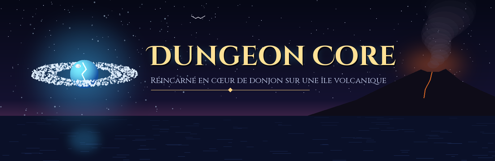
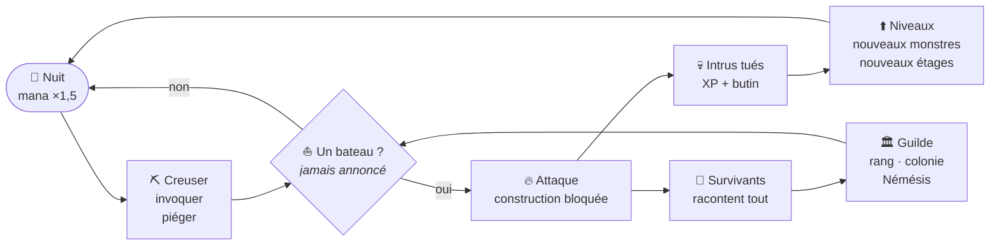

<div align="center">



### *Tu t'es endormi dans ton lit. Tu te réveilles cristal, à la dérive au large d'une île volcanique.*
### *Pas de système, pas de mode d'emploi. Juste du mana, de la roche… et des aventuriers qui finiront par venir.*

<br/>


[**Le jeu**](#-le-jeu) · [**Fonctionnalités**](#-fonctionnalités) · [**Captures**](#-captures) · [**Technique**](#-sous-le-capot) · [**Démarrer**](#-démarrer) · [**Journal**](docs/DEVLOG.md) · [**Crédits**](#-crédits)

</div>

---

## 🔮 Le jeu

**Dungeon Core** est un jeu mobile 2D (pixel art, rendu 2.5D) où l'on incarne un **cœur de donjon réincarné** : une orbe de cristal consciente, échouée dans une grotte au flanc d'un volcan. Librement inspiré du web-roman *The Dungeon Without a System*, il raconte la naissance d'un donjon… et de la ville d'aventuriers qui finit par pousser autour de lui pour le piller.

Le joueur **creuse** son antre, **invoque** des monstres, pose **pièges, portes et trésors**, puis survit à des expéditions de plus en plus dangereuses : pêcheurs égarés, villageois armés de fourches, aventuriers organisés, chevaliers, héros.

Trois intentions guident tout le développement :

| Intention | En jeu |
|---|---|
| 🌋 **La beauté** | Île générée procéduralement, relief 2.5D, lumières dynamiques, cycle jour/nuit, cinématiques mises en scène. |
| 😨 **La peur constante** | Personne n'annonce les bateaux. Pendant une attaque, on ne peut plus rien construire : *il faut toujours être prêt*. |
| 🧠 **Un vrai jeu de labyrinthe** | Les intrus ne connaissent pas le donjon : ils l'explorent, le cartographient, se perdent… et reviennent s'ils survivent. |

---

## ✨ Fonctionnalités

<table>
<tr>
<td width="50%" valign="top">

### 🏰 Mode Noyau — bâtir le donjon
- **Creuser** la roche case par case ; le donjon *est* ton corps.
- **15 familles de monstres**, chacune avec **3 stades d'évolution** (rat, slime, gobelin, squelette, champignon, orc, zombie, imp, gnoll, homme-lézard, fantôme, golem, liche, vampire, démon).
- **Pièges**, **coffres** (appâts à remplir de butin), **portes et herses** (opaques tant qu'elles sont fermées), **escaliers**, décor, trophées.
- **Étages thématiques** débloqués aux niveaux 4 / 9 / 14 (lave, eaux, glace, champignons, cristal, crypte, forteresse).
- **Possession** d'un monstre (joystick virtuel), ordres de patrouille et de garde, gardiens d'étage, prison pour les intrus assommés.
- **Économie au mana** : réserve limitée (150 au niveau 1), régénération plus forte la nuit, **entretien quotidien** de chaque monstre et coffre.

</td>
<td width="50%" valign="top">

### ⚔️ Les intrus — ils apprennent
- Progression **pêcheurs → villageois → aventuriers → chevaliers → héros**, selon ta menace et ta renommée.
- Groupes à **rôles** : guerrier, archer, mage, soigneur.
- **Brouillard de guerre** : chaque expédition dessine sa propre carte, suit une galerie jusqu'au bout, contourne les obstacles, pille les coffres qu'elle voit.
- **Némésis** : les survivants reviennent plus forts, avec le souvenir de *leur* carte et des pièges qu'ils ont vus.
- **Raids nocturnes**, fuites, corruption, trêves, expéditions punitives.

### 🏛️ La Guilde et la colonie
- Un pêcheur rescapé donne l'alerte → **équipe d'évaluation** → **rang officiel** du donjon (F à SSS).
- Une **colonie** s'installe : camp, port, hameau, puis ville d'aventuriers qui vit de toi… et rêve de ta chute.

</td>
</tr>
<tr>
<td valign="top">

### 🗡️ Mode Aventurier — de l'autre côté
- Explorer la ville **à pied**, entrer dans les bâtiments, parler aux PNJ, acheter armes et potions.
- Former un **groupe** à la Guilde.
- Descendre un **donjon procédural de 10 étages**, gardiens nommés (Grukk, Sa'Veth), points de passage, pierres de rappel.
- **8 directions**, course avec **endurance**, **roulade** d'esquive, gestes (fouiller, boire, prier).
- **Armure visible** sur 9 paliers et **personnalisation** (nom, cheveux, peau, tenue).

</td>
<td valign="top">

### 🎬 Atmosphère
- **Cinématiques** : naissance du cristal (7 scènes, adaptée du chapitre 1 du roman), premier bateau, alerte à la Guilde (scène d'intérieur avec dialogues), verdict, croissance de la colonie.
- **Événements** d'île : tempêtes, brouillard, éruptions, lune de sang, naufrages.
- **Pénombre souterraine**, torches des intrus qui approchent dans le noir, détails de sol et ombres au pied des murs, flash et micro-pause à l'impact.
- **Musique adaptative** (un morceau calme va toujours au bout ; le combat coupe), ambiances et bruitages **générés procéduralement**.
- Profils, sauvegardes (auto + 3 emplacements), 4 difficultés dont *Impitoyable*, succès.

</td>
</tr>
</table>

### La boucle de jeu



---

## 📸 Captures

> 🚧 *Les captures d'écran et GIF arrivent bientôt dans `docs/screenshots/`.*

---

## 🛠️ Sous le capot

| Domaine | Détails |
|---|---|
| **Moteur** | Unity **6000.3.8f1** · Universal Render Pipeline 2D (Light2D, tri par axe Y) · Input System |
| **Navigation** | [A* Pathfinding Project](https://arongranberg.com/astar/) 4.2 (GridGraph, tags pour les portes, chemins personnalisés pour l'exploration) |
| **Code** | **~27 000 lignes de C#** (119 fichiers) — interface entièrement construite par code, aucun prefab d'UI |
| **Outils** | **~2 000 lignes de Python** (Pillow, NumPy, SciPy) : découpe des packs, murs auto-raccordés, relief 2.5D, sprites dérivés, bruitages et ambiances, bannière |
| **Génération** | 12 menus éditeur `DungeonCore/…` : île procédurale (graine 1337), catalogue, import des personnages et tilesets, relief, routes, polices, APK |
| **Cible** | Android (IL2CPP, ARM64), paysage, interface adaptative + zones sûres |

Points d'architecture remarquables — détaillés dans [**docs/ARCHITECTURE.md**](docs/ARCHITECTURE.md) :

- **`IntruderMap`** : la carte mentale d'une expédition (sol, murs, obstacles, cristal aperçu), exploration par frontières avec maintien du cap.
- **`DungeonDoor`** : une porte fermée bloque la vue, les tirs et le passage des monstres (sauf sur ordre) ; forcée une fois, elle reste ouverte.
- **`GuildSystem` / `NemesisSystem` / `ReputationSystem`** : le monde se souvient de toi.
- **`CinematicDirector`** (+ `CinematicIntro`) : caméra, lumière globale, sous-titres, bulles de dialogue, HUD révélé morceau par morceau.

L'outillage (menus, scripts Python, pont de test automatisé) est décrit dans [**docs/OUTILS.md**](docs/OUTILS.md).

---

## 🚀 Démarrer

> [!IMPORTANT]
> Ce dépôt est **public sans les assets tiers** : leurs licences interdisent de les redistribuer.
> Il contient le code, les outils, les scènes et données générées, et nos propres créations.
> Pour reconstruire le projet jouable, il faut d'abord récupérer les packs listés dans [**docs/ASSETS.md**](docs/ASSETS.md).

1. Installer **Unity 6000.3.8f1** (avec le module *Android Build Support* pour le mobile).
2. Cloner le dépôt :
   ```bash
   git clone https://github.com/theogalland-eng/DungeonCore.git
   ```
3. Ajouter les dépendances tierces (voir [docs/ASSETS.md](docs/ASSETS.md)) :
   - **A\* Pathfinding Project** (version gratuite 4.2.x) dans `Assets/AstarPathfindingProject/` ;
   - les **packs graphiques craftpix** dans `Assets/imports/` ;
   - *TextMesh Pro Essentials* (Unity le propose à l'ouverture).
4. Ouvrir le projet, puis relancer les menus de génération `DungeonCore/…` (catalogue, personnages, tilesets, île…).
5. Ouvrir `Assets/Scenes/SampleScene.unity` et lancer ▶️.
6. Pour le téléphone : `DungeonCore → 10. Construire l'APK (Android)`.

---

## 📜 Journal de développement

Le jeu a été construit par itérations courtes, chacune partant des retours de jeu.
Chaque étape — île procédurale, Guilde, brouillard de guerre, portes, cinématique d'intro… — est racontée dans [**docs/DEVLOG.md**](docs/DEVLOG.md).

| Période | Grandes étapes |
|---|---|
| **24 sept.** | Île procédurale, étages thématiques, interface en code, import des personnages et tilesets |
| **25 sept.** | Familles de monstres et évolutions, entretien, colonie humaine, sauvegardes et profils, butin |
| **26 sept.** | Relief 2.5D, groupes à rôles, Guilde et rangs F→SSS, difficultés |
| **27 sept.** | Peur constante, Némésis, événements, prison, mode Aventurier, économie au mana |
| **1er oct.** | Brouillard de guerre, nouveau menu, cinématique de la Guilde, APK Android |
| **2 oct.** | Exploration v2, portes opaques, pillage des coffres, verrou d'attaque, nouvelle intro |

---

## 🗺️ Et ensuite ?

- [ ] Captures d'écran et GIF de présentation
- [x] Musiques (composées avec Gemini Music)
- [ ] Équilibrage des expéditions sur des parties longues
- [ ] Sauvegarde du mode Aventurier
- [ ] Comptes et sauvegardes en ligne

---

## 🙏 Crédits

- **Conception et direction** : Théo Galland
- **Développement** : réalisé avec l'aide de [Claude Code](https://claude.com/claude-code) (Anthropic)
- **Inspiration** : *The Dungeon Without a System* (web-roman)
- **Graphismes** : packs [craftpix.net](https://craftpix.net) (non inclus), créations [PixelLab](https://www.pixellab.ai) (incluses), sprites et effets dérivés générés par nos scripts
- **Polices** : [Cinzel](https://fonts.google.com/specimen/Cinzel) et Cinzel Decorative — SIL Open Font License (incluses)
- **Navigation** : A* Pathfinding Project par Aron Granberg (non inclus)

Détail des sources et licences : [**docs/ASSETS.md**](docs/ASSETS.md).

<div align="center">
<br/>
<sub>© Théo Galland — tous droits réservés sur le code et les créations originales de ce dépôt.</sub>
<br/>
<sub><i>« Si je dois être un donjon… autant être un bon donjon. »</i></sub>
</div>
