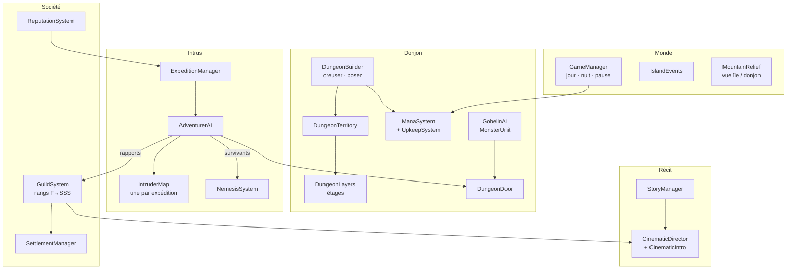

<div align="center">

# 🧭 Architecture

*Carte du code de Dungeon Core : où vit chaque système, et comment ils se parlent.*

[← Retour au README](../README.md)

</div>

---

## Arborescence

```text
DungeonCore/
├── Assets/
│   ├── scripts/            ← le jeu (C#)
│   │   ├── Systems/        ← ~80 systèmes : mana, Guilde, portes, cinématiques, sauvegarde…
│   │   ├── UI/             ← HUD, panneau latéral, menu, colonie (interface construite en code)
│   │   ├── Settlement/     ← la colonie humaine
│   │   └── *.cs            ← cœur, intrus (AdventurerAI), monstres (GobelinAI), construction
│   ├── Editor/             ← générateurs et pipeline (menus DungeonCore/…), pont de test
│   ├── Scenes/             ← SampleScene : l'île générée
│   ├── Prefabs/ · animations/   ← personnages et clips générés par l'importeur
│   ├── Resources/          ← catalogue, polices Cinzel, sons procéduraux
│   └── Art/PixelLab/       ← créations PixelLab
├── Tools~/                 ← scripts Python (découpe, murs, relief, sons, sprites dérivés…)
├── ProjectSettings/ · Packages/
└── docs/                   ← cette documentation
```

> Le suffixe `~` de `Tools~` fait ignorer le dossier par Unity : les scripts Python n'y sont jamais importés comme assets.

---

## Vue d'ensemble



---

## Les systèmes, par thème

### 🏰 Le donjon

| Script | Rôle |
|---|---|
| [`DungeonCore.cs`](../Assets/scripts/DungeonCore.cs) | Le cristal : points de vie, pulsation, déplacement. S'il se brise, la partie est perdue. |
| [`DungeonBuilder.cs`](../Assets/scripts/DungeonBuilder.cs) | Modes de construction (creuser, poser, invoquer, déplacer le cœur) ; verrou `UnderAttack`. |
| [`DungeonTerritory.cs`](../Assets/scripts/Systems/DungeonTerritory.cs) | Les cases qui forment le donjon, connexité, entrée, emplacements libres. |
| [`DungeonLayers.cs`](../Assets/scripts/Systems/DungeonLayers.cs) | Étages thématiques, déblocages par niveau, vue courante. |
| [`ManaSystem.cs`](../Assets/scripts/Systems/ManaSystem.cs) · [`UpkeepSystem.cs`](../Assets/scripts/Systems/UpkeepSystem.cs) | Réserve, régénération (nuit, prestige), entretien quotidien. |
| [`PlacedObject.cs`](../Assets/scripts/Systems/PlacedObject.cs) | Objets posés ; le décor encombrant devient un obstacle physique et pour A*. |
| [`DungeonDoor.cs`](../Assets/scripts/Systems/DungeonDoor.cs) | Porte = mur tant qu'elle est fermée (vue, tirs, passage) ; sprites de face ou de profil. |
| [`TreasureChest.cs`](../Assets/scripts/Systems/TreasureChest.cs) | Appât : se remplit de butin, pillé avec animation. |
| [`ThemedRooms.cs`](../Assets/scripts/Systems/ThemedRooms.cs) | Crypte, armurerie, trésorerie, sanctuaire : bonus quand le décor est regroupé. |

### 👹 Les monstres

| Script | Rôle |
|---|---|
| [`GobelinAI.cs`](../Assets/scripts/GobelinAI.cs) | IA commune à tous les monstres (patrouille, garde, ordres, raids, accès aux portes). |
| [`MonsterUnit.cs`](../Assets/scripts/Systems/MonsterUnit.cs) · [`MonsterTraits.cs`](../Assets/scripts/Systems/MonsterTraits.cs) | Expérience, évolution en 3 stades, entretien, capacités (vol de vie, invocations…). |
| [`MonsterMind.cs`](../Assets/scripts/Systems/MonsterMind.cs) | Gardiens d'étage et monstres qui parlent. |
| [`PossessionController.cs`](../Assets/scripts/Systems/PossessionController.cs) | Le joueur prend le contrôle d'un monstre. |

### 🧭 Les intrus

| Script | Rôle |
|---|---|
| [`ExpeditionManager.cs`](../Assets/scripts/Systems/ExpeditionManager.cs) | Arrivée des bateaux (jamais annoncée), composition des groupes, carte par expédition. |
| [`AdventurerAI.cs`](../Assets/scripts/AdventurerAI.cs) | Exploration, combat par rôle, fuite, pillage, ligne de vue (portes comprises). |
| [`IntruderMap.cs`](../Assets/scripts/Systems/IntruderMap.cs) | Carte mentale : sol, murs, obstacles, cristal aperçu ; recherche de frontières, chemins sur le connu. |
| [`NemesisSystem.cs`](../Assets/scripts/Systems/NemesisSystem.cs) | Les survivants reviennent plus forts, avec leur carte. |
| [`RaidSystem.cs`](../Assets/scripts/Systems/RaidSystem.cs) · [`RelationSystem.cs`](../Assets/scripts/Systems/RelationSystem.cs) | Raids nocturnes, corruption, trêves. |

### 🏛️ La société

| Script | Rôle |
|---|---|
| [`GuildSystem.cs`](../Assets/scripts/Systems/GuildSystem.cs) | Inconnu → signalé → évaluation → rang officiel ; jauges d'avidité et d'hostilité. |
| [`ReputationSystem.cs`](../Assets/scripts/Systems/ReputationSystem.cs) | Menace et renommée → niveau des expéditions. |
| [`SettlementManager.cs`](../Assets/scripts/Settlement/SettlementManager.cs) | La colonie : camp → port → hameau → ville. |
| [`InteriorSystem.cs`](../Assets/scripts/Systems/InteriorSystem.cs) | Intérieurs des bâtiments (visites, cinématiques). |

### 🗡️ Le mode Aventurier

| Script | Rôle |
|---|---|
| [`CrawlerMode.cs`](../Assets/scripts/Systems/CrawlerMode.cs) | Ville, boutiques, Guilde, étages, points de passage. |
| [`CrawlerDungeon.cs`](../Assets/scripts/Systems/CrawlerDungeon.cs) | Génération déterministe des 10 étages et de leurs gardiens. |
| [`CrawlerPlayer.cs`](../Assets/scripts/Systems/CrawlerPlayer.cs) · [`CrawlerCompanion.cs`](../Assets/scripts/Systems/CrawlerCompanion.cs) | Le héros et ses compagnons. |

### 🎬 Récit, ambiance, interface

| Script | Rôle |
|---|---|
| [`CinematicDirector.cs`](../Assets/scripts/Systems/CinematicDirector.cs) | Bandes noires, sous-titres, caméra, cartons, tampons, bulles de dialogue, file de cinématiques. |
| [`CinematicIntro.cs`](../Assets/scripts/Systems/CinematicIntro.cs) | L'introduction en 7 scènes (gemme, mana, mouette, grotte). |
| [`StoryManager.cs`](../Assets/scripts/Systems/StoryManager.cs) | Monologue du Noyau et astuces, déclenchés par les événements du jeu. |
| [`MusicManager.cs`](../Assets/scripts/Systems/MusicManager.cs) · [`Sfx.cs`](../Assets/scripts/Systems/Sfx.cs) | Musique adaptative, ambiances, bruitages. |
| [`GameHUD.cs`](../Assets/scripts/UI/GameHUD.cs) · [`SidePanel.cs`](../Assets/scripts/UI/SidePanel.cs) · [`MainMenu.cs`](../Assets/scripts/UI/MainMenu.cs) | Interface construite en code ; `UIKit` partagé, `AdaptiveScaler` et `SafeArea` pour le mobile. |
| [`SaveSystem.cs`](../Assets/scripts/Systems/SaveSystem.cs) · [`ProfileStore.cs`](../Assets/scripts/Systems/ProfileStore.cs) | Profils, sauvegardes JSON, rechargement de l'état. |

---

## Conventions

- **Une classe `MonoBehaviour` par fichier**, nommé comme la classe (exigence de Unity pour les scènes et prefabs).
- **Code et commentaires en français**, comme le jeu.
- **Calques physiques** : 6 = murs (obstacles A*), 7 = aventuriers, 8 = monstres, 10 = portes (`Door`).
- **Tags A\*** : le tag 1 marque les portes fermées ; les monstres l'évitent sauf sur ordre.
- **Interface sans prefabs** : tout est créé par code au démarrage, ce qui simplifie les adaptations mobiles.
- **Données générées** : catalogue, prefabs, animations, tuiles et carte sortent des menus éditeur ; on ne les retouche pas à la main, on relance le générateur.
