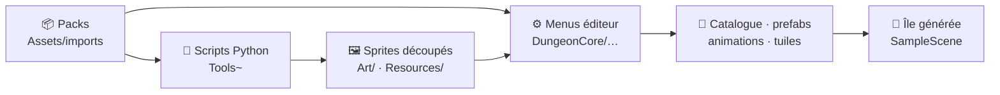

# 🛠️ Outils et pipeline

*Comment les packs graphiques deviennent un jeu : menus éditeur, scripts Python, génération et tests automatisés.*

[← Retour au README](../README.md)

---

## Le principe

Presque rien n'est assemblé à la main. Les **packs graphiques** sont posés dans `Assets/imports/`, puis :

Relancer un générateur reproduit le même résultat : la carte utilise une graine fixe (1337), et les catalogues sont reconstruits à partir des règles écrites dans le code.

---

## ⚙️ Menus éditeur `DungeonCore/…`

| Menu | Fichier | Ce qu'il fait |
|---|---|---|
| **1. Importer le tileset de l'île** | `Editor/CatalogBuilder.cs` | Prépare les tuiles de l'île (sable, herbe, roche, mer). |
| **2. Générer le catalogue et les prefabs** | `Editor/CatalogBuilder.cs` | Construit `Resources/DungeonCatalog.asset` : monstres triés par niveau, pièges, décor, portes, coffres, thèmes d'étage. |
| **3. Générer l'île** ⚠️ | `Editor/IslandGenerator.cs` | Recrée toute la carte : relief, côtes, forêt, grotte de départ, sentier, ponton, parcelles de la colonie. *Remplace la carte existante.* |
| **4. Importer les personnages** | `Editor/CharacterImporter.cs` | Découpe les planches, crée les clips 4 directions, les contrôleurs, les prefabs et les icônes. |
| **5. Importer les tilesets** | `Editor/TilesetImporter.cs` | Tuiles 16 px et palettes. |
| **6. Murs, sols et arbres** | `Editor/WallBuilder.cs` | Murs auto-raccordés par thème, sols à motifs, pivots des arbres. |
| **7. Importer colonie, pièges et décors** | `Editor/ArtImporter.cs` | Bandes d'animation `nom_LxH.png`, pivots et échelles par famille d'objets. |
| **8. Relief de l'île (2.5D)** | `Editor/ReliefBuilder.cs` | Exporte le masque de la montagne, puis assemble les bandes de relief. |
| **9. Routes pavées** | `Editor/RoadBuilder.cs` | Pave le sentier et les rues de la colonie. |
| **10 / 11. APK Android** | `Editor/ApkBuilder.cs` | IL2CPP, ARM64 → `Builds/DungeonCore.apk` ; le menu 11 installe directement en USB. |
| **12. Créer les polices (Cinzel)** | `Editor/FontMaker.cs` | Polices TextMesh Pro des titres et matériau lumineux. |
| Configurer pour mobile (paysage) | `Editor/ProjectSetup.cs` | Orientation paysage et réglages du lecteur. |

---

## 🐍 Scripts Python (`Tools~/`)

Prérequis : Python 3 avec **Pillow**, **NumPy** et **SciPy**. À lancer depuis la racine du projet, par exemple `python "Tools~/make_sfx.py"`.

| Script | Rôle |
|---|---|
| `segment.py` · `preview.py` | Repère automatiquement chaque objet d'une planche (→ `Tools~/segments/*.json`) et en fait un aperçu numéroté. |
| `crop_assets.py` · `crop_dungeon.py` | Découpe les objets choisis (colonie, pièges, décor) en sprites ou bandes d'animation. |
| `crop_doors.py` | Portes, herses, escaliers… et **dessine les portes vues de profil** pour les couloirs gauche-droite. |
| `crop_fx.py` · `crop_loot.py` · `crop_interiors.py` | Effets visuels, butin et trophées, intérieurs des bâtiments. |
| `make_walls.py` | Atlas de 128 variantes de murs auto-raccordés par thème. |
| `make_relief.py` | Relief 2.5D du volcan, calculé à partir de la forme de la montagne (distance au bord, ombrage, strates). |
| `make_water.py` | Mer animée raccordable. |
| `make_roles.py` | Archer, mage et soigneuse **recomposés à partir des calques de l'épéiste** (tenue recolorée, arc et bâton dessinés). |
| `make_gull.py` | La mouette de la cinématique d'intro (vol, chute, posée). |
| `make_sfx.py` · `make_ambience.py` | **Bruitages et ambiances entièrement synthétisés** (coups, sorts, pièges, ressac, souffle de caverne, battements de cœur). |
| `make_banner.py` | La bannière de ce README. |
| `pixellab*.py` · `build_pixellab_sheets.py` | Client de l'API PixelLab : création d'objets et de personnages, téléchargement, assemblage en planches. |

> 🔐 Les scripts PixelLab lisent le jeton dans la variable d'environnement `PIXELLAB_TOKEN` ; aucun jeton n'est jamais écrit dans le dépôt.

---

## 🤖 Tests automatisés : le pont éditeur

Le jeu est testé **en jouant réellement** dans l'éditeur, piloté de l'extérieur :

- [`Editor/ClaudeBridge.cs`](../Assets/Editor/ClaudeBridge.cs) surveille `Temp/claude_cmd.txt` et exécute `refresh`, `play`, `stop` ou `exec Type.Méthode`, puis écrit le résultat dans `Temp/claude_log.txt`.
- [`Editor/DevInspect.cs`](../Assets/Editor/DevInspect.cs) et [`DevInspect2.cs`](../Assets/Editor/DevInspect2.cs) regroupent des centaines de sondes et de mises en situation : lancer une expédition, poser des portes, creuser un labyrinthe, photographier une zone, faire défiler une cinématique, passer les dialogues automatiquement…

Exemple de session : `play` → `exec DevInspect.MenuNewGame` → captures toutes les 4 s → lecture de l'état de la cinématique. C'est ainsi qu'on a trouvé, par exemple, que passer l'intro au mauvais moment figeait le jeu.

---

## 📱 Construire pour Android

1. Installer le module *Android Build Support* (SDK, NDK, OpenJDK) avec Unity Hub.
2. `DungeonCore → 10. Construire l'APK (Android)` → `Builds/DungeonCore.apk`.
3. Copier l'APK sur le téléphone et autoriser l'installation d'applications inconnues, ou brancher en USB et utiliser le menu **11**.

> Si Gradle échoue avec *« Could not move temporary workspace »* : arrêter le démon Java d'Unity puis supprimer `~/.gradle/caches/<version>/transforms`.
